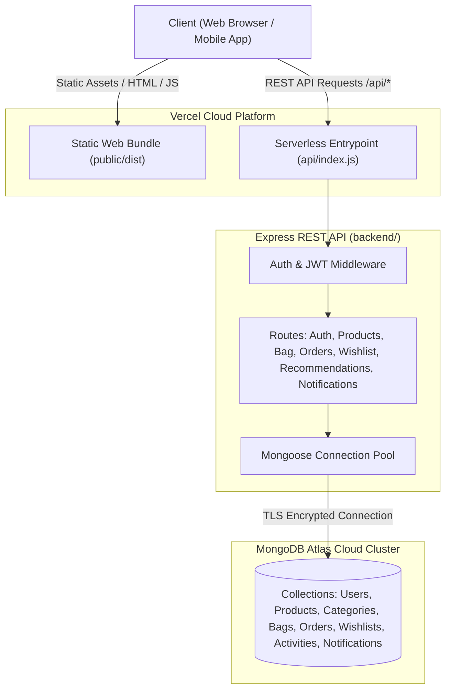
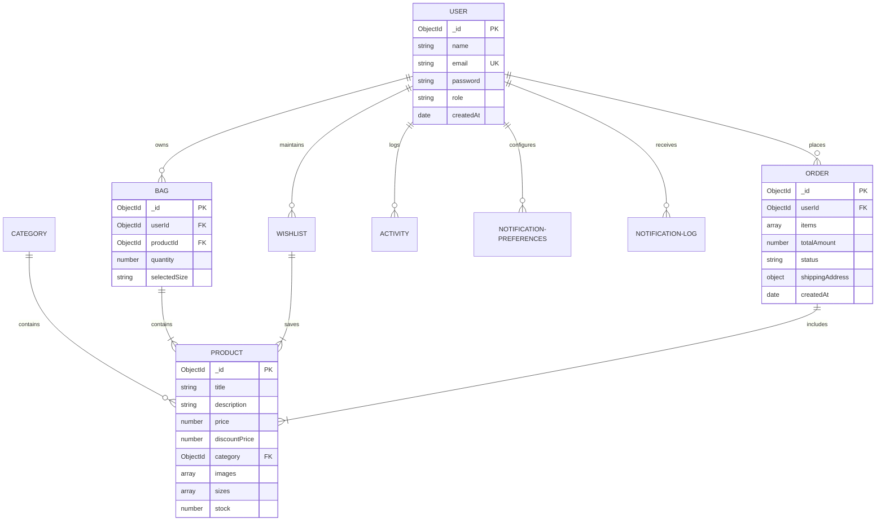
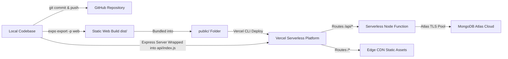

# Project Report: Full-Stack Myntra Clone Application

**Author / Developer:** Harsh Bait  
**GitHub Repository:** [https://github.com/harshbaithub/myntra-clone](https://github.com/harshbaithub/myntra-clone)  
**Live Production Deployment:** [https://myntra-clone-main-theta.vercel.app](https://myntra-clone-main-theta.vercel.app)  
**Version:** 1.0.0 (Production Release)  
**Date:** October 17, 2026  

---

## 1. Executive Summary

The **Myntra Clone** is an end-to-end, cross-platform e-commerce web and mobile application inspired by India's leading fashion e-commerce portal, Myntra. The application provides a modern, fast, and intuitive shopping experience across web browsers and mobile devices. 

It is engineered with a decoupled full-stack architecture featuring a **React Native (Expo SDK 52) multiplatform frontend**, an **Express.js / Node.js RESTful API engine**, and a high-availability cloud database hosted on **MongoDB Atlas**. The entire application has been deployed seamlessly onto **Vercel** with optimized serverless server routes and a static web bundle, backed by continuous version control on **GitHub**.

---

## 2. Project Objectives

1. **Pixel-Perfect & Responsive UI/UX**: Replicate the signature aesthetic and UX patterns of Myntra, including brand color palettes, high-impact hero banners, category grids, dynamic carousels, and persistent bottom navigation.
2. **Cross-Platform Delivery**: Enable code reuse between Web, Android, and iOS through React Native and Expo Router.
3. **Comprehensive E-Commerce Capabilities**: Implement an entire retail flow from product discovery, dynamic filtering, wishlisting, bag management, to checkout and order tracking.
4. **Intelligent Personalization**: Provide user activity tracking and a recommendation engine tailored to user browsing history and past purchases.
5. **Robust Cloud Infrastructure**: Ensure zero local database dependency by connecting to MongoDB Atlas with connection pooling, automated serverless deployment on Vercel, and secure environment isolation.

---

## 3. System Architecture

The project employs a modern 3-tier architecture with a serverless edge delivery model.

---

## 4. Technology Stack

| Layer | Technologies & Libraries | Key Responsibilities |
| :--- | :--- | :--- |
| **Frontend Framework** | **React Native (Expo SDK 52)**, **Expo Router v4** | Universal file-based routing, native mobile UI & responsive web layout |
| **UI & Styling** | React Native StyleSheet, Custom CSS, Vector Icons (`@expo/vector-icons`) | Fluid typography, responsive grids, dark/light themes, badges |
| **State Management** | React Context API (`AuthContext`, `ActivityContext`) | Global user session state, real-time activity tracking, cart synchronization |
| **Backend Runtime** | **Node.js**, **Express.js** | RESTful endpoints, request validation, authentication, business logic |
| **Database & ODM** | **MongoDB Atlas**, **Mongoose ODM v8** | Cloud NoSQL persistence, schema validation, relationship modeling, connection pooling |
| **Security & Auth** | **JWT (JSON Web Tokens)**, **bcryptjs** | Salted password hashing, stateless token authorization, route protection |
| **Cloud Deployment** | **Vercel** (`@vercel/node`) | Hybrid static edge hosting + serverless API execution |
| **Version Control** | **Git**, **GitHub** | Branch management (`main`), code revision tracking, release distribution |

---

## 5. Functional Modules & Core Features

### 5.1. Authentication & Security
- **User Registration & Login**: Validated user signup with email and password, hashed securely using `bcryptjs`.
- **JWT Authorization**: Issues signed JSON Web Tokens stored securely on the client to authenticate subsequent API requests.
- **Session Persistence**: Maintains user state across browser refreshes and application relaunches.

### 5.2. Catalog & Discovery Engine
- **Hierarchical Categories**: Categories like Men, Women, Kids, Beauty, and Footwear with sub-category filters.
- **Product Details Page**: High-resolution image galleries, price discount indicators, size selectors, ratings, and detailed descriptions.
- **Full-Text Search & Filters**: Search products by title, category, brand, and tags.

### 5.3. Shopping Bag & Checkout
- **Real-Time Bag Sync**: Add, update quantity, and remove items with real-time price, discount, and tax calculations.
- **Persistent Cart**: User bag items are saved to MongoDB Atlas, ensuring cart continuity across devices.
- **Order Placement**: Multi-step checkout with delivery address selection, order summary, and order confirmation.

### 5.4. Wishlist & Favorites
- One-tap add/remove to wishlist from product cards and product detail views.
- Quick transfer from Wishlist directly to the Shopping Bag.

### 5.5. Order Management & Tracking
- **Order History**: Comprehensive list of placed orders with status tracking (`Pending`, `Processing`, `Shipped`, `Delivered`).
- **Item Breakdown**: Complete order summaries including pricing snapshots at purchase time and delivery timestamps.

### 5.6. Activity & Recommendation Engine
- **User Activity Logging**: Records view events, search keywords, and purchase activities.
- **Smart Recommendations**: Algorithmic suggestions based on category affinity and frequently viewed items.

### 5.7. Notification System
- **Notification Preferences**: Configurable user settings for order updates, promotional offers, and price drops.
- **Notification Logs**: Centralized record of notifications delivered to the user with read/unread flags.

---

## 6. Database Schema & Data Models

The application utilizes 8 core MongoDB collections structured with Mongoose:

---

## 7. API Architecture & Verification Results

All endpoints have been verified against both the local development environment and the live Vercel production deployment.

| Endpoint | HTTP Method | Module | Description | Test Status |
| :--- | :---: | :--- | :--- | :---: |
| `/api/user/signup` | `POST` | Auth | Register new user account | Passed |
| `/api/user/login` | `POST` | Auth | Authenticate user & return JWT token | Passed |
| `/api/category` | `GET` | Catalog | Retrieve list of all product categories | Passed |
| `/api/product` | `GET` | Catalog | Retrieve all products with optional filters | Passed |
| `/api/product/:id` | `GET` | Catalog | Get detailed product specifications | Passed |
| `/api/bag` | `GET` | Cart | Fetch authenticated user's shopping bag | Passed |
| `/api/bag` | `POST` | Cart | Add item to shopping bag with selected size | Passed |
| `/api/bag/:id` | `DELETE` | Cart | Remove specific product from bag | Passed |
| `/api/wishlist` | `GET` | Wishlist | Retrieve user's wishlist collection | Passed |
| `/api/wishlist` | `POST` | Wishlist | Toggle / add item to wishlist | Passed |
| `/api/Order` | `POST` | Orders | Create and place a new purchase order | Passed |
| `/api/Order/my-orders` | `GET` | Orders | Fetch current user's past orders | Passed |
| `/api/activity` | `POST` | Analytics | Record user browsing and interaction events | Passed |
| `/api/activity/history` | `GET` | Analytics | Retrieve recorded user activity logs | Passed |
| `/api/recommendations` | `GET` | Recommendations | Fetch personalized product recommendations | Passed |
| `/api/notification/preferences` | `GET` / `PUT` | Notifications | Read / update user notification settings | Passed |
| `/api/notification/logs` | `GET` | Notifications | Fetch in-app notifications and announcements | Passed |

---

## 8. Deployment & DevOps Infrastructure

### Key Deployment Optimizations
1. **Serverless Database Connection Caching**:
   Mongoose's connection instance is cached across warm serverless execution containers in `backend/server.js`, preventing database exhaustion during traffic spikes.
2. **Unified Routing via `vercel.json`**:
   Configured custom route rewrites to direct API requests to the `/api/index.js` serverless function while delegating all HTML and asset routes to the Expo static build in `public/`.
3. **Environment Security**:
   Cloud database credentials (`MONGO_URI`, `JWT_SECRET`) are securely injected via environment configurations, and excluded from GitHub using `.gitignore`.
4. **Custom Branding**:
   Injected custom Myntra branding, official vector favicons, and metadata tags into the Expo HTML templates for enhanced browser presentation.

---

## 9. Deliverables & Reference Links

- **GitHub Source Code:** [harshbaithub/myntra-clone](https://github.com/harshbaithub/myntra-clone)
- **Live Production Application:** [https://myntra-clone-main-theta.vercel.app](https://myntra-clone-main-theta.vercel.app)
- **Primary Branch:** `main` (clean, verified, up to date with remote)
- **Database Engine:** MongoDB Atlas (AWS cluster, Mongoose 8.x)
- **Frontend Stack:** React Native 0.76.7 / Expo 52.0.46 / React 18.3.1

---

## 10. Conclusion & Future Roadmap

The Myntra Clone demonstrates a complete, commercially styled full-stack application built to modern web and mobile standards. With its live deployment on Vercel, MongoDB Atlas cloud backbone, and clean GitHub repository, it is ready for demonstration, portfolio presentation, and future feature expansion.

**Recommended Next Phases:**
- Integration of a live payment gateway (Razorpay / Stripe).
- Automated CI/CD pipeline using GitHub Actions for auto-deployments on git push.
- Standalone Android APK build generation using Expo Application Services (EAS Build).
